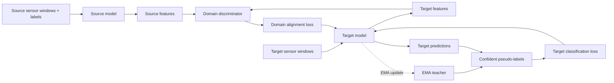
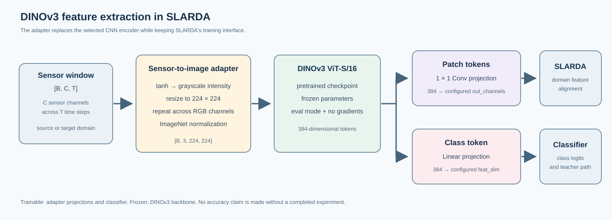

# SLARDA: Time-Series Domain Adaptation with an Optional DINOv3 Encoder

This repository contains the reference implementation of **Self-supervised Autoregressive Domain Adaptation for Time Series Data (SLARDA)** and a course-project extension that adds a frozen **DINOv3 ViT-S/16** encoder for multivariate sensor windows.

Original SLARDA work by Mohamed Ragab, Emadeldeen Eldele, Zhenghua Chen, Min Wu, Chee-Keong Kwoh, and Xiaoli Li; published in *IEEE Transactions on Neural Networks and Learning Systems*.

> **Course-project scope:** the DINOv3 integration is an additional selectable encoder. The original CNN models remain available. The integration is documented in [`README_DINOV3.md`](README_DINOV3.md); model-specific run instructions are in [`Autorgressive_Adaptation/README.md`](Autorgressive_Adaptation/README.md).

## Project at a glance

| Item | Description |
| --- | --- |
| Original task | Unsupervised domain adaptation for time-series classification |
| Adaptation setting | Train on a labeled source domain and adapt to a target domain |
| Course extension | Use DINOv3 ViT-S/16 patch and class-token features as the selected model's encoder |
| Input | A sensor window represented as `[batch, channels, time]` |
| Output | One class-logit vector per sensor window |
| DINOv3 training policy | Frozen pretrained backbone; trainable feature projections and classifier |
| Main training entrypoint | `Autorgressive_Adaptation/train_CD.py` |
| Default dataset configuration | `Opp_HAR` |

## Original SLARDA method

SLARDA is an unsupervised domain adaptation method for time-series data. In the autoregressive training entrypoint, the source model is trained with source labels and then held fixed; a target model is optimized with a domain-discriminator objective and confident teacher pseudo-labels. The teacher is updated from the target model with an exponential moving average. Dataset-specific configurations define the input-channel count, feature sizes, number of classes, and adaptation hyperparameters.

The DINOv3 extension changes the feature-extraction model selected by the existing training code. It does not rewrite the source/target training loop, discriminator, teacher update, evaluation pipeline, or dataset split logic. See the [original SLARDA paper](https://arxiv.org/abs/2111.14834) for the research method and the integration guide for the exact code changes in this repository.

At a high level, source labels train the initial source classifier. Target-domain features are then adapted using the existing domain discriminator and confident teacher predictions:



The diagram summarizes the code path in `trainer/SLARDA.py`; it is not a reported experimental result.

## DINOv3 integration



Sensor signals are not RGB images. The adapter in `Autorgressive_Adaptation/models/models.py` treats each `[channels, time]` window as a 2D matrix, bounds its values with `tanh`, maps it to grayscale intensity, resizes it to 224 × 224, repeats it over RGB, and applies ImageNet normalization. DINOv3 then produces patch and class tokens. Trainable projections map those tokens to the feature dimensions expected by SLARDA.

This is a practical modality adapter for the course assignment. It does not convert sensor data into natural imagery, and this repository does not claim that DINOv3 improves accuracy without completed experiments.

### Model flow

```text
Sensor window [B, C, T]
        │
        ▼
Bounded grayscale raster → 224 × 224 RGB → ImageNet normalization
        │
        ▼
Frozen DINOv3 ViT-S/16
        ├── patch tokens → trainable 1×1 projection → SLARDA domain features
        └── class token  → trainable linear projection → classifier / teacher path
```

The new model returns the same general structure used by the existing trainers:
`(logits, (latent_features, sequence_features))`. The patch-token projection uses the selected dataset's configured `out_channels`; the class-token projection uses `feat_dim`.

### CNN baseline and DINOv3 option

| Aspect | Original `CNN_Opp_HAR_SL` | New `DINOv3_SLARDA` |
| --- | --- | --- |
| Input representation | 1D sensor sequence | Sensor matrix rasterized as RGB input |
| Feature extractor | Trainable 1D convolution blocks | Frozen DINOv3 ViT-S/16 |
| Sequence features | Convolution output over reduced sequence length | Projected spatial patch-token sequence |
| Classification vector | Adaptive average pooling | Projected DINOv3 CLS token |
| Additional asset | None beyond the code and dataset | Local DINOv3 source checkout and ViT-S/16 checkpoint |
| Trainer interface | Existing SLARDA trainer | Same existing SLARDA trainer |

Both choices produce class logits and the latent/sequence feature pair consumed by the SLARDA code. This makes them selectable under the same training entrypoint, but their sequence features have different meanings and should be compared empirically before drawing conclusions.

### Losses and parameter updates

The integration leaves the existing loss and optimization flow intact. The source-only stage trains the selected encoder's trainable parameters with labeled source data. During cross-domain adaptation, the discriminator learns source-versus-target feature labels; the target model receives a domain-alignment loss and a teacher pseudo-label loss for target samples above the configured confidence threshold. The teacher is updated from the target model using momentum. DINOv3 itself remains frozen; its trainable projection and classifier are included in the selected model's parameters.

No numerical result is included because the required checkpoint and prepared data have not yet been supplied for this project workspace.

## Repository map

| Path | Purpose |
| --- | --- |
| `Autorgressive_Adaptation/` | Main source/target domain adaptation implementation and DINOv3 integration |
| `Autorgressive_Adaptation/models/models.py` | Original feature extractors, discriminator models, and the new `DINOv3_SLARDA` class |
| `Autorgressive_Adaptation/trainer/SLARDA.py` | Source-only initialization, domain-adaptation loop, teacher update, and evaluation calls |
| `Autorgressive_Adaptation/config_files/` | Dataset and model hyperparameters |
| `Autorgressive_Adaptation/dataloader/dataloader.py` | Loads prepared train/validation/test `.pt` files by domain |
| `Self-supervised training/` | Separate self-supervised pretraining and fine-tuning entrypoint |
| `README_DINOV3.md` | Detailed DINOv3 integration, tensor flow, checkpoint setup, and validation status |

## Research context

The original SLARDA paper addresses domain shift in time-series classification. Its method combines a source-side self-supervised forecasting objective, domain alignment that models temporal feature dependence, and confident teacher pseudo-labels for class-wise target adaptation. The supplied repository contains separate self-supervised and autoregressive adaptation directories; the DINOv3 course change is scoped to the latter.

In the autoregressive adaptation entrypoint, `train_CD.py` forms source-target pairs from domain split filenames. For each pair, `trainer/SLARDA.py` creates a source model, target model, teacher model, and feature discriminator. The source model starts from a labeled source-only checkpoint; the target and teacher are initialized from that source checkpoint. The source and teacher are frozen. Target predictions from the teacher are used only when their confidence exceeds the configuration threshold, and the teacher is updated from the target model by a momentum step.

### Supported task configurations

| Dataset configuration | Base-model examples | Data type |
| --- | --- | --- |
| `Opp_HAR` | `CNN_Opp_HAR_SL`, `DINOv3_SLARDA` | Multivariate wearable sensor windows |
| `Paderborn_FD` | `CNN_SL_bn` and dataset-specific model choices | Rotating-machine fault signals |
| `EEG` | `EEG_M_SL` and dataset-specific model choices | EEG time-series windows |

Model classes, channel counts, class counts, and discriminator settings are defined in `Autorgressive_Adaptation/config_files/`. The DINOv3 model should only be selected for configurations whose input channel count and class labels match the prepared data.

## Data contract and experiment organization

The autoregressive data loader reads one PyTorch file per split and domain. With the default Opp_HAR configuration, the expected root is `Autorgressive_Adaptation/data/Opp_HAR/`:

```text
data/Opp_HAR/
├── train_a.pt   # source training split for domain a; target windows when a is target
├── val_a.pt
├── test_a.pt
├── train_b.pt
├── val_b.pt
├── test_b.pt
└── ...
```

Each loaded object is expected to contain `samples` and `labels`. The train loader shuffles windows and uses the configured batch size; validation and test loaders use half that batch size. The DINOv3 adapter checks that the final model input is rank 3 and has the configured number of channels. For Opp_HAR, the target shape is `[B, 113, T]`. The legacy loader uses a shape heuristic to arrange the channel axis, so confirm the output shape before training.

Domain IDs are derived from the character after the `train_` prefix, so the provided training script expects one-character IDs such as `a`, `b`, `c`, and `d`. It iterates over ordered pairs and skips same-domain pairs. Target labels are available to the evaluation loader, but the adaptation loss in `trainer/SLARDA.py` is formed from domain labels and confident teacher pseudo-labels rather than target ground-truth labels.

The raw Opportunity dataset is not the `.pt` structure read by this repository. Obtain raw data from [UCI](https://archive.ics.uci.edu/dataset/226/opportunity%2Bactivity%2Brecognition), then prepare windows, labels, and domain splits according to the project data format before running experiments. See the [adaptation data guide](Autorgressive_Adaptation/README.md#data-layout).

## Model selection and comparison

The default `--base_model` is `CNN_Opp_HAR_SL`. Setting `--base_model DINOv3_SLARDA` opts into the new DINOv3 model. The model selection is an addition; the original CNN classes remain available for a baseline run.

| Behavior | CNN baseline | DINOv3 model |
| --- | --- | --- |
| Feature input | Direct sensor sequence | Sensor matrix converted into a raster image |
| Encoder | Trainable 1D convolutional layers | Frozen ViT-S/16 backbone |
| Trainable feature layers | CNN encoder and classification layers | Patch projection, class-token projection, classifier |
| Source/target trainer | Existing SLARDA trainer | Same trainer |
| Checkpoint requirement | Source-only task checkpoint | DINOv3 pretrained checkpoint plus source-only task checkpoint created by the run |

For a meaningful baseline comparison, keep the dataset splits, label mapping, number of runs, random seeds, and evaluation procedure consistent. The two models produce features with different structures, so report them as separate model configurations rather than treating their internal features as directly equivalent.

## Environment and external assets

The original repository README lists Python, PyTorch, NumPy, scikit-learn, pandas, and `mat4py` for preprocessing. The supplied SLARDA project does not include a complete version-pinned environment file. The DINOv3 extension also depends on the requirements of the local DINOv3 source checkout and its PyTorch Hub implementation. Record exact package versions and hardware when reporting results; the syntax compilation check alone does not establish runtime compatibility.

Two assets are intentionally external to this source tree:

1. **DINOv3 ViT-S/16 weights**, obtained through the [Meta DINOv3 access page](https://ai.meta.com/resources/models-and-libraries/dinov3-downloads/).
2. **Prepared SLARDA dataset files**, stored under the ignored `data/` directory rather than in Git.

The model code does not download pretrained weights automatically. It requires explicit paths to the local DINOv3 repository and checkpoint at run time. Avoid committing the model weights, raw datasets, generated checkpoints, or experiment logs.

## Setup and run

### 1. Prepare DINOv3

Clone or use the provided local DINOv3 source directory. Separately obtain a **ViT-S/16 checkpoint** through Meta's [DINOv3 access page](https://ai.meta.com/resources/models-and-libraries/dinov3-downloads/). The source repository contains the model implementation; it does not include pretrained weights. The official [DINOv3 README](https://github.com/facebookresearch/dinov3#pretrained-models) describes loading local checkpoint files with PyTorch Hub.

### 2. Prepare the dataset

The default `Opp_HAR` run expects prepared PyTorch files under `Autorgressive_Adaptation/data/Opp_HAR/`, with one `train_<domain>.pt`, `val_<domain>.pt`, and `test_<domain>.pt` per domain. Each file must contain the `samples` and `labels` entries used by the project data loader. Raw Opportunity files are not loaded directly by this training entrypoint; see the [UCI dataset page](https://archive.ics.uci.edu/dataset/226/opportunity%2Bactivity%2Brecognition) and the [data instructions](Autorgressive_Adaptation/README.md#data-layout).

### 3. Run the DINOv3 model

From `Autorgressive_Adaptation`, provide the local DINOv3 repository and checkpoint paths:

```powershell
python train_CD.py `
  --selected_dataset Opp_HAR `
  --base_model DINOv3_SLARDA `
  --dinov3_repo "C:\path\to\dinov3-main" `
  --dinov3_weights "C:\path\to\dinov3_vits16_checkpoint.pth" `
  --device cuda `
  --num_runs 1
```

Use `--device cpu` if CUDA is unavailable; the run will be slower. `--num_runs 1` requests one run per source-target scenario. The script's default is three runs. The CNN baseline can still be selected with the original `--base_model` names described in `Autorgressive_Adaptation/args.py`.

To run the CNN comparison with the same data and SLARDA settings, omit the DINOv3-only path arguments and select the original model:

```powershell
python train_CD.py `
  --selected_dataset Opp_HAR `
  --base_model CNN_Opp_HAR_SL `
  --device cuda `
  --num_runs 1
```

Run both commands from the same `Autorgressive_Adaptation` working directory. The DINOv3 model requires a local checkpoint file; the original CNN model does not.

## What was updated for the course project

| File | Update |
| --- | --- |
| `Autorgressive_Adaptation/models/models.py` | Added the sensor-to-image adapter, local DINOv3 ViT-S/16 loading, frozen token extraction, trainable projections, and classifier in `DINOv3_SLARDA`. |
| `Autorgressive_Adaptation/args.py` | Added the model selection description and CLI options for the local DINOv3 repository and checkpoint. |
| `README_DINOV3.md` | Added the detailed implementation walkthrough and run/validation notes. |
| `Autorgressive_Adaptation/README.md` | Added dataset layout and operational instructions for the adaptation code. |
| `figures/dinov3-slarda-architecture.svg` | Added an architecture diagram for the README. |

### Reproduction checklist

- [ ] Install a Python environment with dependencies compatible with the SLARDA code and local DINOv3 checkout.
- [ ] Obtain the official DINOv3 ViT-S/16 checkpoint and keep it outside the submission repository.
- [ ] Prepare the train/validation/test `.pt` files for each source/target domain.
- [ ] Run a DINOv3 forward-pass smoke check on one batch.
- [ ] Run the desired cross-domain scenarios and record the command, environment, and measured metrics.

The README intentionally marks the last three checks as pending until they are actually completed.

## Validation status

The changed Python files passed a syntax compilation check. A DINOv3 forward-pass smoke run and a full SLARDA training run have not been performed in this workspace because the required pretrained checkpoint and prepared dataset are not present. Therefore, no accuracy, speed, or baseline-comparison figures are reported.

## Citation

If you use the original SLARDA research, cite:

```bibtex
@article{ragab2022self,
  title={Self-supervised Autoregressive Domain Adaptation for Time Series Data},
  author={Ragab, Mohamed and Eldele, Emadeldeen and Chen, Zhenghua and Wu, Min and Kwoh, Chee Keong and Li, Xiaoli},
  journal={IEEE Transactions on Neural Networks and Learning Systems},
  year={2022},
  doi={10.1109/TNNLS.2022.3183252}
}
```

For the pretrained vision encoder, also acknowledge [DINOv3](https://github.com/facebookresearch/dinov3) and follow its license and model-use terms.

Original project contact: Mohamed Ragab, School of Computer Science and Engineering, Nanyang Technological University, Singapore (`mohamedr002@e.ntu.edu.sg`).
